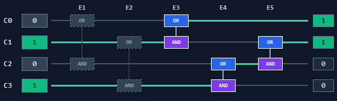

# MSNBP — Réseau de tri Binaire de Taille minimale
*(Minimal Sorting Network with Binary Principle)*

Outil de recherche, vérification et simulation visuelle de réseaux de tri / câblages booléens minimaux, avec interface **Tkinter** en français, moteur **masques de bits** et solveur natif **Rust** multi-cœurs.

---

## 📚 Prérequis : comprendre les notations

### Qu'est-ce qu'un réseau de tri booléen ?

Un **réseau de tri** est un circuit composé de **comparateurs** qui trie des listes de nombres. Dans notre projet, nous travaillons avec des **bits** (0 et 1) : chaque fil transporte une valeur 0 ou 1, et chaque comparateur est une **porte logique à deux entrées et deux sorties**.

### Notations

| Notation | Nom | Signification |
|----------|------|-------------|
| **N** | Nombre de câbles/fils | Exemple : N=7 signifie qu'on trie 7 bits d'entrée |
| **C₀, C₁, ..., C_{N-1}** | Câbles | Les fils du circuit, numérotés de 0 (haut) à N-1 (bas) |
| **E₁, E₂, ..., E_K** | Étapes | Chaque comparateur posé est une étape. E₁ est la première porte |
| **(c₁, c₂)** | Paire de câbles | Une porte relie le câble c₁ et le câble c₂. Exemple : (0, 1) relie C₀ et C₁ |
| **K** | Nombre total de portes | Taille du réseau. L'objectif est de minimiser K pour un N donné |
| **OR / AND** | Portes logiques | « OU » et « ET » : les deux fonctions booléennes que chaque comparateur applique |
| **u64 / u128 / U256** | Types de masques | Tailles d'entiers machine utilisées pour coder les bits : 64, 128 ou 256 bits |
| **Écart (span)** | |c₂ - c₁| | Distance entre les deux câbles d'une porte. Écart 1 = adjacents |
| **BFS** | Parcours en largeur | Algorithme qui explore toutes les possibilités couche par couche |
| **Préfixe L1 / L2** | Premières couches | Les premières portes posées, souvent parallèles |
| **Couche parallèle** | | Groupe de portes qui relient des paires de câbles **disjoints** (aucun câble commun) |

### Qu'est-ce qu'une porte OR/AND ?

Un comparateur (c₁, c₂) fonctionne ainsi :
- **Sortie du haut** (câble c₁) : `max(entrée₁, entrée₂)` = `entrée₁ **OU** entrée₂`
- **Sortie du bas** (câble c₂) : `min(entrée₁, entrée₂)` = `entrée₁ **ET** entrée₂`

**Exemple concret :**
Si C₀=1 et C₁=0 entrent dans un comparateur (0,1) :
- C₀ sort = 1 OU 0 = **1** (le max)
- C₁ sort = 1 ET 0 = **0** (le min)

Après plusieurs portes, les bits se retrouvent triés : tous les 1 en haut, tous les 0 en bas.

### Qu'est-ce que N ?

**N** est le nombre de câbles (bits d'entrée). Par exemple :
- **N=3** : trier 3 bits → optimum connu : 3 comparateurs
- **N=5** : trier 5 bits → optimum : 9 comparateurs
- **N=7** : trier 7 bits → optimum : 16 comparateurs (un grand classique)
- **N=8** : trier 8 bits → optimum : 19 comparateurs

La suite des optima est référencée dans l'encyclopédie OEIS A003075 : 0, 1, 3, 5, 9, 12, 16, 19, 25, ...

### Exemple visuel : un réseau N=4 en 5 portes (optimum)



*Capture d'écran de l'application LogicNetworkExplorer. Chaque rectangle bleu/violet est un comparateur OR/AND. Les pastilles vertes à gauche sont les bits d'entrée (cliquables pour simuler). Les câbles sont numérotés de C₀ à C₃. À droite, le badge "TRIÉ OK" confirme que la sortie est correctement ordonnée.*

### Qu'est-ce que la forme de Foata ?

Deux comparateurs **disjoints** (qui ne touchent pas les mêmes câbles) peuvent être **échangés** sans changer le résultat. Par exemple (0,1) et (2,3) peuvent être inversés car ils n'ont aucun câble commun.

La **forme normale de Foata** consiste à regrouper les portes en **couches** :
- Chaque couche ne contient que des comparateurs disjoints
- On remplit chaque couche au maximum avant de passer à la suivante

Cette normalisation permet de **comparer** deux réseaux qui effectuent le même tri mais dans un ordre différent, et de réduire l'espace de recherche.

### Qu'est-ce que la symétrie par réflexion ?

Si on prend un réseau et qu'on le **retourne** (haut ↔ bas), on obtient un autre réseau valide. Mathématiquement : remplacer chaque porte (c₁, c₂) par (N-1-c₁, N-1-c₂).

Cette symétrie permet de diviser par 2 le nombre de cas à explorer.

### Qu'est-ce qu'une projection N → N-1 ?

Si on **supprime** le câble du haut (C₀) ou du bas (N-1) d'un réseau, ainsi que toutes les portes qui y sont connectées, on obtient un réseau valide pour N-1 câbles. Cette propriété permet de **construire des réseaux optimaux par récurrence**.

---

## Fonctionnalités
- **Recherche de câblages minimaux :**
  - *Couches BFS — Moteur Rust (Multi-cœurs)* : recherche par profondeur avec masques de bits (`u64` / `u128` / `U256`) et déduplication d'états.
  - *Couches BFS + Dédup. d'états (Python)* : repli portable sans binaire Rust.
  - *Permutations de sous-ensembles (Parallèle)* : exploration parallèle sur plusieurs workers.
- **Vérificateur & Simulateur interactif :** table de vérité complète, détection des entrées en échec, simulation pas à pas et **mode édition à la souris** (ajout/suppression de connexions directement sur le schéma).
- **Mode portable & cache local :** stocke les réglages et résultats dans `logic_network_data/` à côté de l'exécutable/script (avec repli mémoire si lecture seule).
- **API HTTP locale** : contrôle à distance depuis l'agent AI pour piloter l'interface, injecter des solutions et lancer des analyses.
- **Double panneau d'analyse** : compare deux collections côte-à-côte avec surbrillance des différences.
- **Workflow L1/L2** : extrait les motifs d'ouverture les plus fréquents et les réinjecte comme préfixe de recherche.
- **Solveur Rust étendu** : support de N=8 avec type `U256` (2 × u128).
- **Support des préfixes de recherche** : option `--prefix` pour fixer les premières couches et réduire l'espace d'état.
- **Coupe de commutation Foata** : évite d'explorer des permutations équivalentes.
- **Filtre d'écart final** : les réseaux optimaux finissent toujours par des portes adjacentes.

## Résultats de recherche

| N | Comparateurs optimaux | Solutions trouvées | Exemple de réseau (couches Foata) | Type de masque |
|---|----------------------|-------------------|----------------------------------|----------------|
| 3 | 3 | **5** | `(0,1) (0,2) (1,2)` — 7 séquences (DAG complet) | `u64` |
| 4 | 5 | **5** | `(0,2) (1,3) (0,1) (2,3) (1,2)` — 87 séquences (DAG complet) | `u64` |
| 5 | 9 | **340** | `(0,1) (2,3) (0,2) (1,3) (1,2) (3,4) (0,1) (2,3) (1,2)` — 149 040 séquences (DAG complet) | `u64` |
| 6 | 12 | **1 725** | 12 portes optimales | `u64` |
| 7 | 16 | **541** (6 familles de préfixes) | 16 portes, profondeur 6-11 | `u128` |
| 8 | 19 | **726** (4 familles de préfixes) | 19 portes, profondeur 6-9 | `U256` (2 × u128) |

**Note :** pour N=3 et N=4, les solutions optimales sont exhaustivement connues depuis les travaux de Batcher (1968). Le DAG complet de N=3 contient 7 chemins optimaux, celui de N=4 en contient 87. Les fichiers `solutionsn3k3.json` et `solutionsn4k5.json` contiennent les représentants canoniques.

## 📦 Installation rapide (5 minutes)

### Option 1 : Exécutable portable (recommandé)

1. Télécharge `LogicNetworkExplorer.exe` et `rust_solver.exe` depuis la section **Releases**
2. Place les **deux fichiers dans le même dossier**
3. Lance `LogicNetworkExplorer.exe` — c'est tout

Les fichiers de solutions (`solutionsn*.json`) sont chargés automatiquement.

### Option 2 : Compilation depuis les sources

**Prérequis :**
- Python 3.7+ (testé avec Python 3.7 et 3.12)
- Rust 1.63+ (`rustc` disponible)
- MikTeX ou toute distribution LaTeX (optionnel, pour compiler le PDF des preuves)

**Étapes :**

```powershell
# 1. Compiler le solveur Rust
rustc -O -C target-cpu=native rust_solver.rs -o rust_solver.exe

# 2. Lancer l'interface Python
python logic_network_gui.py

# (Optionnel) Compiler l'exécutable Windows
pip install pyinstaller
pyinstaller --noconfirm --onedir --windowed --name LogicNetworkExplorer logic_network_gui.py

# (Optionnel) Compiler le PDF des preuves
pdflatex proofs.tex
pdflatex proofs.tex
```

### Utilisation en ligne de commande (solveur seul)

```powershell
# N=7 avec préfixe L1+L2 (6 portes), 10 portes BFS
rust_solver.exe --cables 7 --start-size 10 --max-size 10 --max-solutions 50 --workers 6 --prefix 0,1,2,3,4,5,0,2,1,3,4,6

# N=8 avec préfixe L1+L2 (8 portes), 11 portes BFS
rust_solver.exe --cables 8 --start-size 11 --max-size 11 --max-solutions 30 --workers 6 --prefix 0,1,2,3,4,5,6,7,0,2,1,3,4,6,5,7
```

### API HTTP distante

Quand l'application est lancée, un serveur HTTP est exposé sur `127.0.0.1:39227` (token : `dsh-lnetwork-2024`).

```powershell
# Obtenir l'état de l'application
curl "http://127.0.0.1:39227/status?token=dsh-lnetwork-2024"

# Lancer une recherche N=7
curl -X POST "http://127.0.0.1:39227/search?token=dsh-lnetwork-2024" -H "Content-Type: application/json" -d '{"cables":7,"max_solutions":10}'
```

### Preuves mathématiques

Un document PDF de 9 propriétés structurelles avec preuves (certaines démontrées, d'autres observations empiriques) est disponible :
- **Source LaTeX** : `proofs.tex`
- **PDF compilé** : `proofs.pdf` (cliquez pour télécharger)

## Journal des modifications

### 21 novembre 2026 — Refonte majeure

#### Solveur Rust (`rust_solver.rs`)
- **Compactage RAM des `worker_buckets`** : les tuples `([W; MAX_N], u32, u8)` de 128 octets ont été remplacés par `(u32, u8)` de 8 octets (le nouvel état est recalculé en Phase 2 depuis l'état parent). Permet de passer de 46,9 Go à ~10 Go au pic sur N=7.
- **Option `--prefix`** : fixe les premières portes (L1, L1+L2) avant le BFS. Réduit la frontière de couche 7 de 27 M états à 15 279 pour N=7 avec L1.
- **Coupe de commutation Foata** (`--no-foata`) : évite d'évaluer des permutations équivalentes de portes disjointes.
- **Filtre d'écart final** (`--no-final-span-1`) : à `depth == max_size`, ne tester que les paires adjacentes (écart 1).
- **Support N=8** : ajout du type `U256` (2 × u128) pour les masques de bits à 8 câbles. Les niveaux N≤6 et N=7 continuent d'utiliser `u64` et `u128`.
- **Correction d'index** : les index de portes stockés dans `parents` référencent toujours la liste complète, même quand la couche finale utilise les portes adjacentes uniquement.

#### Interface Python (`logic_network_gui.py`)
- **Ajout d'une API HTTP locale** (`127.0.0.1:39227`, token `dsh-lnetwork-2024`) pour piloter l'application à distance. Endpoints : `/status`, `/collections`, `/solutions`, `/search`, `/set-prefix`, `/import-solutions`, `/switch-tab`, `/run-analysis`, `/select-solution`, `/select-primary`, `/stop-search`, `/send-to-mso`.
- **Architecture thread-safe** : les appels Tkinter sont marshallés vers le thread principal via `root.after()`.
- **Double panneau d'analyse** dans l'onglet Analyse : panneau gauche (jeu principal), panneau central (comparaison A↔B avec surbrillance), panneau droit (jeu croisé).
- **Nouvelles métriques statistiques** : distribution de la dernière porte E_K, patterns L1, profondeur parallèle ASAP, symétries par réflexion, projection N→N-1.
- **Workflow L1/L2** : les boutons "Extraire L1" et "Envoyer L1+L2 → MSO" analysent les patterns d'ouverture les plus fréquents et les réinjectent dans l'onglet MSO.
- **Champ Préfixe** dans l'onglet MSO : zone de texte pour saisir les portes de préfixe (transmises au solveur Rust via `--prefix` ou appliquées directement dans le BFS Python).
- **Options de coupe** : cases à cocher pour la coupe Foata et le filtre d'écart final.
- **Auto-chargement** des fichiers `solutionsn*.json` au démarrage.
- **Chargement automatique des collections** : restauration des jeux de solutions N=5, N=6, N=7, N=8 à l'ouverture.
- **Corrections de bugs** : résolution du deadlock Tkinter lors des appels API, correction des variables `diff_a`/`diff_b` non définies.

#### Exécutables
- **Compilation en mode `--onedir`** (remplace `--onefile`) : évite l'extraction temporaire dans `%TEMP%` qui causait l'erreur `INTERNAL ERROR: cannot create temporary directory!`.
- **Distribution** : `dist/LogicNetworkExplorer/` contient l'application, le solveur Rust, les fichiers de solutions et les données.

#### Solutions
- **N=3 : 5 solutions à 3 comparateurs** — représentants canoniques.
- **N=4 : 5 solutions à 5 comparateurs** — représentants canoniques.
- **N=5 : 340 solutions à 9 comparateurs** (un représentant par état pénaltième unique, sur 149 040 séquences réelles).
- **N=6 : 1 725 solutions à 12 comparateurs**.
- **N=7 : 541 solutions à 16 comparateurs** (38 originales + 503 par réflexion et commutation), réparties en **6 familles** de préfixes L1+L2.
- **N=8 : 726 solutions à 19 comparateurs** (52 originales + 674 par réflexion et commutation), réparties en **4 familles** de préfixes.
- **Projection N→N-1 validée** : 100% des solutions N=8 et N=7 se projettent correctement sur N-1.
- **100% des solutions fiables** : chaque solution est vérifiée via `run_full_verification()`.

## Propriétés structurelles des réseaux de tri binaires minimaux (OR, AND)

### 1. Activité par câble (distribution en cloche)
L'activité des comparateurs par câble suit une **courbe en cloche symétrique** : les câbles centraux portent significativement plus de portes que les câbles extrêmes.

**Observations :**
- **N=5** : C2 est le câble le plus actif, C0 et C4 les moins actifs.
- **N=6** : C2 et C3 sont les plus actifs, C0 et C5 les moins actifs.
- **N=7** : C3 est le plus actif (6 portes dans le réseau optimal de couche 3×3), C0 et C6 les moins actifs.
- **N=8** : Même profil en cloche, les câbles centraux (C3, C4) dominent.

### 2. Écart des portes (span)
La distribution des écarts |c₂ - c₁| évolue continûment de l'entrée vers la sortie :
- **Aux premières étapes (E1-E3)** : les écarts sont distribués proportionnellement au nombre de paires de chaque écart (40% d'écart 1, 30% d'écart 2, etc.).
- **Aux étapes intermédiaires** : la proportion de portes adjacentes (écart 1) croît à chaque étape.
- **À la dernière étape E_K** : **100% des réseaux optimaux** (N=3 à N=8) terminent par une porte d'**écart 1** (paire adjacente).

**Mesures (sur 541 solutions N=7) :**
- Écart 1 : 42,7% des portes E1..E15 ; **100% de E16**
- Écart 2 : 30,3%
- Écart 3 : 14,3%
- Écart 4 : 10,4%
- Écart 5 : 1,6%
- Écart 6 : 0,7% (jamais d'écart max en fin de réseau)

**Mesures (sur 726 solutions N=8) :**
- Écart 1 : 41,0% des portes E1..E18 ; **100% de E19**
- Écart 2 : 29,7%
- Écart 3 : 10,1%
- Écart 4 : 14,5%
- Écart 5 : 3,2%
- Écart 7 : 1,4%

### 3. Fermeture du réseau
- **100% des réseaux optimaux** de N=3 à N=8 se terminent par une porte d'écart 1.
- La dernière porte E_K est toujours une paire **adjacente centrale** (jamais une paire extrême comme (0,1) dans plus de 97% des cas pour N=7).
- Aucun réseau optimal (et optimal+1 sans porte redondante) ne se termine par un écart supérieur à 1.

**Distribution de E16 (N=7, 515 solutions) :**
- (3,4) : 28,3%
- (2,3) : 24,9%
- (1,2) : 23,1%
- (4,5) : 12,6%
- (5,6) : 8,2%
- (0,1) : 2,9%

**Distribution de E19 (N=8, 726 solutions) :**
- (1,2) : 38,5%
- (5,6) : 38,5%
- (3,4) : 23,1%

### 4. Ouverture du réseau (première couche L1)
Les réseaux optimaux privilégient **la mise en parallèle immédiate** des fils :
- **N=5** : 73,3% des 149 040 chemins optimaux démarrent par une couche parallèle de 2 comparateurs disjoints.
- **N=6, 7, 8** : l'ouverture par 3 (N=6,7) ou 4 (N=8) paires mutuellement disjointes est le motif dominant.
- Le motif `(0,1),(2,3),(4,5)` (ou sa symétrie centrée) est le **pattern L1 le plus fréquent** pour N≥5.

### 5. Symétrie par réflexion haut/bas
La transformation `(c₁, c₂) → (N-1-c₁, N-1-c₂)` est une **symétrie exacte** du graphe des solutions optimales :
- **100% des 515 solutions N=7** ont un symétrique valide.
- Appliquée aux classes de Foata, cette symétrie divise l'espace par 2, laissant **5 895 orbites canoniques** pour N=5 (sur 11 790 classes de Foata).

### 6. Projection N → N-1
Tout réseau optimal à N câbles dont un câble extrême (C₀ ou C_{N-1}) porte exactement `k` portes induit un réseau optimal sur les N-1 autres câbles après suppression de ce câble et des `k` portes qui le touchent.

**Validation empirique :**
- **N=7 → N=6** : 100% des 515 solutions N=7 se projettent valablement sur N=6.
- **N=8 → N=7** : 100% des 726 solutions N=8 se projettent valablement sur N=7.

### 7. Profondeur parallèle ASAP (As Soon As Possible)
Le regroupement glouton par couches parallèles (forme normale de Foata) donne une mesure de **profondeur parallèle** :

**Distribution N=7 (515 solutions) :**
| Profondeur | Pourcentage |
|-----------|------------|
| 6 couches | 1,4% |
| 7 couches | 19,0% |
| 8 couches | **48,0%** |
| 9 couches | 27,2% |
| 10 couches | 4,1% |
| 11 couches | 0,4% |

**Distribution N=8 (726 solutions) :**
| Profondeur | Pourcentage |
|-----------|------------|
| 6 couches | 11,5% |
| 7 couches | **46,2%** |
| 8 couches | 38,5% |
| 9 couches | 3,8% |

### 8. Proportion de portes adjacentes
La proportion de comparateurs adjacents (écart 1) est remarquablement stable :
- **N=5** : 58,5%
- **N=6** : 54,9%
- **N=7** : 46,3%
- **N=8** : 44,1%

Cette proportion décroît légèrement avec N, ce qui est cohérent avec le nombre croissant de paires non adjacentes disponibles.

### 9. Réseau optimal canonique N=7 (profondeur 6, 16 portes)
Le réseau de profondeur parallèle 6 vérifié comme optimal illustre la compression progressive des 128 vecteurs d'entrée :

| Couche | Portes | Vecteurs distincts | Paires inversées |
|--------|--------|-------------------|-----------------|
| Initial | — | 128 | 63 |
| L1 (E1-E3) | (0,1),(2,3),(4,5) | 54 | 18 |
| L2 (E4-E6) | (0,2),(1,3),(4,6) | 30 | 14 |
| L3 (E7-E9) | (0,4),(1,5),(2,6) | 19 | 9 |
| L4 (E10-E11) | (1,4),(3,6) | 14 | 6 |
| L5 (E12-E13) | (2,4),(3,5) | 11 | 3 |
| L6 (E14-E16) | (1,2),(3,4),(5,6) | 8 (triés) | 0 |

### 10. Prédiction pour N=9
Basé sur les régularités observées, on peut prédire :
- **Optimum** : 25 comparateurs (suite OEIS A003075 : 0, 1, 3, 5, 9, 12, 16, 19, 25, ...)
- **Dernière porte** : écart 1 (100% de probabilité)
- **Profil de câbles** : courbe en cloche avec C4 comme câble le plus actif
- **Profondeur dominante** : ~10-12 couches parallèles
- **Portes adjacentes** : ~40% du total

## OEIS
- **suite :** https://oeis.org/A003075